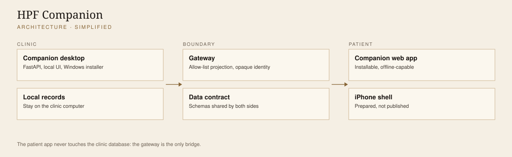

# HPF Companion

> The patient follows their own treatment journey, while clinical records stay on the clinic computer.

**Status** · Prototype &nbsp;·&nbsp; **Area** · Clinical & Patient Experience &nbsp;·&nbsp; **Source code** · private, documentation only

### At a glance

- The patient follows their own journey, and nothing more.
- Clinical records never leave the clinic computer.
- The patient app works offline once installed.

## The problem

Patients leave the clinic with a treatment plan, appointments and instructions on paper.  
They have no clean, safe view of their own journey, and clinical records must not leave the practice to give them one.  

## The solution

The clinic keeps its records on its own computer, and the patient sees only an explicit allow-list of their own journey, published through a narrow gateway.

## My role

Product design and development.  
The project started from the follow-up of patients between appointments.

## Key features

- Clinic desktop app for the team: patient files, documents, treatment plan, quotes and publishing to the patient.
- Gateway that publishes a filtered snapshot of the patient journey, with an explicit list of forbidden fields.
- Patient web app driven by a data contract: treatment plan, protocols, appointments, quote and reports.
- Connection of the patient by an activation code given by the clinic.
- Installable patient app that keeps working offline.
- iPhone shell prepared around the patient web app.

## Screenshots

No screenshot is published: every real screen of this tool would show clinical or case data.  
The simplified architecture below shows how it is built.

## Technologies

Python · FastAPI · SQLite · JavaScript · PWA · Capacitor · Docker · PyInstaller

## Architecture

- Local-first: real records stay on the clinic computer; the gateway projects an allow-list and raises on any forbidden field instead of silently cleaning it.
- Continuous integration builds the gateway image and the Windows desktop app.
- Dependencies are pinned with hashes.

## Development status

- The clinic desktop app runs on the clinic workstation.
- The patient gateway is a prototype on synthetic identities.
- iPhone app: shell prepared, not published on the App Store.
- Health-data hosting is not in place, so no real patient data goes online.

## Privacy and code availability

- Opaque patient identity, HttpOnly session cookies and signed clinic assertions.
- The gateway refuses to start on a public address unless its database is flagged as a prototype.
- No analytics and no third-party SDK.
- The source code of HPF Companion is proprietary and kept in a private repository.
- This repository contains documentation and demonstration screenshots only.
- Demonstrations can be arranged on request.

---

[Hugo Philippe Fusaro](https://github.com/hugophilippefusaro) · [HPF Dental Solutions](https://github.com/hpfdentalsolutions) · [hpfdentalsolutions.com](https://hpfdentalsolutions.com)  
© 2026 Hugo Philippe Fusaro. All rights reserved on texts and images.
